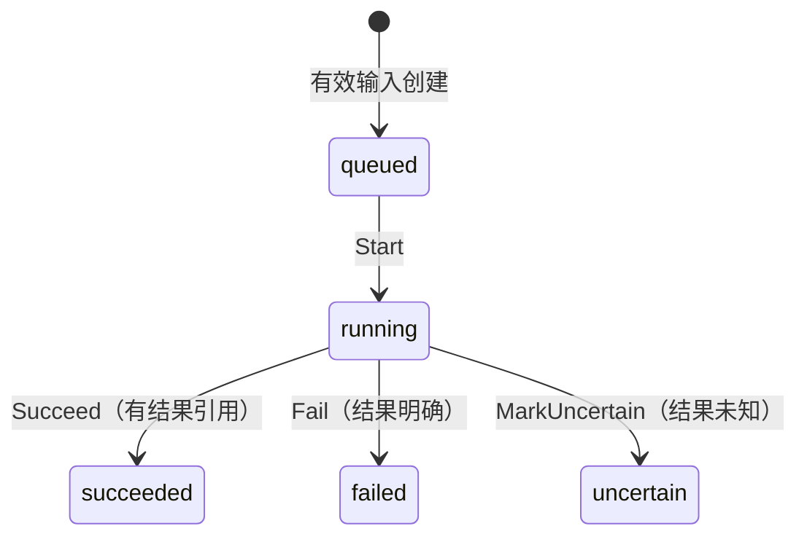

# 生图 V0：任务状态与不确定结果

用户提交一张图，上游可能已经开始生成，你的连接却超时了。此时把任务改回“排队”看起来像在恢复服务，实际可能发起第二次生成，并让同一用户再次付费。

这一篇先实现一条可以亲手验证的规则：任务开始后只能进入成功、明确失败或结果待确认；结果待确认的任务不能直接重新开始。暂时不调用图片 API，不连接数据库，也不扣费。完成后得到的是 Image Studio 中的核心模型，后续 worker 将复用它。

## 起点与范围

从 [Image Studio](https://github.com/JeanphiloGong/image-studio/tree/954224a47546101163e3c21fd86aa80cfaecf085) 的基线 `954224a` 开始。现有 `db/001-initial.sql` 给 `generation_jobs.status` 规定了五个字符串，但没有约束它们之间的转换。现有测试只是插入并读回 `uncertain`，没有证明任务不能再次开始。首页的生成按钮还没有接入请求。

本篇采用计划中推荐的 Go 写法，作为一条可执行的教程路线；产品最终后端选型仍待确定。所有文件加在实际 **Image Studio 产品仓库**，不是本教程仓库。已有代码和两份本地修改的文档 `README.md`、`docs/PRODUCT-SPEC.md` 不需要覆盖。

准备 Go 1.25+。原型回归另需 Node.js 22.17+ 与 pnpm；已有前端依赖时无需重复安装。第一次获取产品仓库可运行：

```bash
git clone https://github.com/JeanphiloGong/image-studio.git
cd image-studio
git switch --detach 954224a47546101163e3c21fd86aa80cfaecf085
pnpm install --frozen-lockfile
```

已有工作目录请核对基线并保留自己的修改，不必执行切换。下文命令都从产品仓库根目录运行。首次创建目录：

```bash
mkdir -p server/internal/generation
```

然后新增 `server/go.mod`（完整文件）：

```gomod
module github.com/JeanphiloGong/image-studio/server

go 1.25.0
```

V0 只用标准库，不需要 chi、数据库驱动或密钥，也不需要执行 `go mod tidy`。原来的 SvelteKit 页面、SQLite 初始化和账本测试暂时保持原样；本篇不承担旧点数模型清理或生产迁移。

## 1. 创建一份归属固定的任务

先回答一个问题：这份任务是谁的，要求生成什么？这些信息创建后应该固定。一个排队任务若在执行前被改成另一个网关用户，就会把消费记到错误的人身上。

本站用户 ID 和网关用户 ID 表示不同身份。构造函数检查它们有效，但不能证明绑定真实可信；认证与绑定验证属于后续账号模块。本篇的调用者是测试，未来 HTTP 边界需要把外部请求解析为明确参数，再通过同一创建入口建立任务。

这里需要的检查只有：身份和模型不能为空；没有有效绑定就不能创建计费归属；空白描述不能生成；提示词限定 1～4000 个 Unicode 字符；画幅采用现有页面的三个选项。创建时检查一次，后续状态方法不重复解析或验证这些参数。模型 ID 只要求有值，不在这里猜测模型权限、价格或图片尺寸。

新增 `server/internal/generation/job.go`，完整内容如下：

```go
package generation

import (
	"errors"
	"strings"
	"unicode/utf8"
)

type Status string

const Queued Status = "queued"

type Job struct {
	id            string
	userID        string
	gatewayUserID int64
	prompt        string
	aspectRatio   string
	model         string
	status        Status
}

func NewJob(id, userID string, gatewayUserID int64, prompt, aspectRatio, model string) (Job, error) {
	if strings.TrimSpace(id) == "" || strings.TrimSpace(userID) == "" || gatewayUserID <= 0 {
		return Job{}, errors.New("job and user identities are required")
	}
	length := utf8.RuneCountInString(strings.TrimSpace(prompt))
	if length < 1 || length > 4000 {
		return Job{}, errors.New("prompt must contain 1 to 4000 characters")
	}
	if aspectRatio != "1:1" && aspectRatio != "16:9" && aspectRatio != "9:16" {
		return Job{}, errors.New("unsupported aspect ratio")
	}
	if strings.TrimSpace(model) == "" {
		return Job{}, errors.New("model is required")
	}
	return Job{
		id: id, userID: userID, gatewayUserID: gatewayUserID,
		prompt: prompt, aspectRatio: aspectRatio, model: model,
		status: Queued,
	}, nil
}

func (j Job) Status() Status {
	return j.status
}
```

字段不导出，让其他包不能直接把状态或归属改掉；`Status()` 只返回一个值。需要哪个读取方法再增加哪个，不先生成一排 getter。构造失败返回错误，不悄悄补默认用户、模型或画幅。

提示词按去掉首尾空白后的 Unicode 码点计数，保存时仍保留用户原文。这也会拒绝全是制表符等空白的描述，比原 SQLite 的 `trim` 更严格；浏览器字符计数只作提示，后续服务端入口须沿用这一明确规则。此处不重复做 JSON 类型或结构校验。

新增 `server/internal/generation/job_test.go`，完整内容如下。`newTestJob` 是后续多个测试共用的有效输入夹具，不是应用里的另一层创建接口。

```go
package generation

import (
	"strings"
	"testing"
)

func newTestJob(t *testing.T) Job {
	t.Helper()
	j, err := NewJob("job-1", "alice", 42, "安静的园林", "1:1", "test-model")
	if err != nil {
		t.Fatal(err)
	}
	return j
}

func TestNewJob(t *testing.T) {
	j := newTestJob(t)
	if j.Status() != Queued || j.userID != "alice" || j.gatewayUserID != 42 || j.prompt != "安静的园林" {
		t.Fatalf("unexpected initial job: %+v", j)
	}
	if _, err := NewJob("job-2", "alice", 42, strings.Repeat("景", 4000), "16:9", "test-model"); err != nil {
		t.Fatalf("4000 characters should be accepted: %v", err)
	}
	cases := []struct {
		name, id, userID string
		gatewayUserID    int64
		prompt, ratio, model string
	}{
		{"missing job", "", "alice", 42, "garden", "1:1", "test-model"},
		{"missing user", "job-1", "", 42, "garden", "1:1", "test-model"},
		{"missing binding", "job-1", "alice", 0, "garden", "1:1", "test-model"},
		{"blank prompt", "job-1", "alice", 42, " \t\n", "1:1", "test-model"},
		{"long prompt", "job-1", "alice", 42, strings.Repeat("景", 4001), "1:1", "test-model"},
		{"wrong ratio", "job-1", "alice", 42, "garden", "2:1", "test-model"},
		{"missing model", "job-1", "alice", 42, "garden", "1:1", ""},
	}
	for _, tc := range cases {
		t.Run(tc.name, func(t *testing.T) {
			_, err := NewJob(tc.id, tc.userID, tc.gatewayUserID, tc.prompt, tc.ratio, tc.model)
			if err == nil {
				t.Fatal("invalid request was accepted")
			}
		})
	}
}
```

执行第一个检查：

```bash
gofmt -w server/internal/generation/*.go
go -C server test ./internal/generation -run '^TestNewJob$' -v
```

预期 `TestNewJob` 及其七个无效输入子场景全部通过，命令退出码为 0。现在你可以建立一份归属固定的排队任务；还不能执行它。下一步只在这个对象上增加行为，不另建任务模型。

## 2. 开始并结束一次执行

一个 `queued` 任务可以开始；开始后成为 `running`，只有这时才能记录执行结果。成功后保存结果引用，失败后保存简短错误码。这里的明确失败表示调用结果已知，不表示网关一定没有收费，模型也不会给用户补余额。

这个模型属于生图任务，消费者是后续 worker；与现有 SQL 行的区别在于它提供状态行为，而不是任意赋值的存储字段。因此不另建 `JobRecord`、DTO 或映射器。当前测试直接调用同一个模型，尚无 HTTP 或数据库调用者需要修改。

在 `job.go` 的 import 列表中增加 `"fmt"`，将列表替换为：

```go
import (
	"errors"
	"fmt"
	"strings"
	"unicode/utf8"
)
```

将 `const Queued ...` 替换成下面整个常量声明：

```go
const (
	Queued    Status = "queued"
	Running   Status = "running"
	Succeeded Status = "succeeded"
	Failed    Status = "failed"
)
```

将 `Job` 的完整结构声明替换为以下内容，`NewJob` 和 `Status()` 保持第一步原样。新增两个结果字段由本步骤的方法写入；它们不会改变任务身份或生成参数。

```go
type Job struct {
	id            string
	userID        string
	gatewayUserID int64
	prompt        string
	aspectRatio   string
	model         string
	status        Status
	resultRef     string
	errorCode     string
}
```

在 `job.go` 的 `Status()` 后追加以下完整方法：

```go
func (j *Job) Start() error {
	if j.status != Queued {
		return fmt.Errorf("cannot start job in %s", j.status)
	}
	j.status = Running
	return nil
}

func (j *Job) Succeed(resultRef string) error {
	if j.status != Running {
		return fmt.Errorf("cannot succeed job in %s", j.status)
	}
	if strings.TrimSpace(resultRef) == "" {
		return errors.New("successful job requires a result reference")
	}
	j.resultRef = resultRef
	j.status = Succeeded
	return nil
}

func (j *Job) Fail(code string) error {
	if j.status != Running {
		return fmt.Errorf("cannot fail job in %s", j.status)
	}
	j.errorCode = code
	j.status = Failed
	return nil
}

func (j Job) ResultRef() string {
	return j.resultRef
}

func (j Job) ErrorCode() string {
	return j.errorCode
}
```

`Start`、`Succeed`、`Fail` 使用指针接收者，因为成功调用会改变当前任务；三个读取方法使用值接收者。`resultRef` 是后续资产流程提供的结果标识，本版只检查成功必须有引用，不伪装成已经验证文件存在。

错误码来自受控的执行调用者，用于保存安全摘要；这里不把外部错误正文解析一遍，也不检查其形状。非法转换直接返回带原状态的错误，由未来调用者决定怎样呈现。所有检查发生在写字段之前，因此被拒绝的操作不能留下半次状态变更。

在 `job_test.go` 末尾追加以下完整测试，原 import 和第一步测试保持不变：

```go
func TestExecution(t *testing.T) {
	cases := []struct {
		name   string
		finish func(*Job) error
		want   Status
		ref, code string
	}{
		{"success", func(j *Job) error { return j.Succeed("asset-1") }, Succeeded, "asset-1", ""},
		{"failure", func(j *Job) error { return j.Fail("provider_rejected") }, Failed, "", "provider_rejected"},
	}
	for _, tc := range cases {
		t.Run(tc.name, func(t *testing.T) {
			j := newTestJob(t)
			before := j
			if err := tc.finish(&j); err == nil || j != before {
				t.Fatal("queued job accepted a result or was changed")
			}
			if err := j.Start(); err != nil {
				t.Fatal(err)
			}
			running := j
			if err := j.Start(); err == nil || j != running {
				t.Fatal("running job was started again or was changed")
			}
			if err := j.Succeed(" "); err == nil || j != running {
				t.Fatal("empty result was accepted or changed the job")
			}
			if err := tc.finish(&j); err != nil {
				t.Fatal(err)
			}
			if j.Status() != tc.want || j.ResultRef() != tc.ref || j.ErrorCode() != tc.code {
				t.Fatalf("unexpected outcome: %+v", j)
			}
			if j.id != before.id || j.userID != before.userID || j.gatewayUserID != before.gatewayUserID ||
				j.prompt != before.prompt || j.aspectRatio != before.aspectRatio || j.model != before.model {
				t.Fatal("execution changed ownership or input")
			}
			final := j
			for _, action := range []func() error{
				j.Start,
				func() error { return j.Succeed("asset-2") },
				func() error { return j.Fail("replacement") },
			} {
				if err := action(); err == nil || j != final {
					t.Fatal("terminal result was overwritten")
				}
			}
		})
	}
}
```

测试同包是为了比较整个任务值，确保错误返回后既没有换状态，也没有悄悄修改结果或身份。这里的结构只有字符串、整数和状态值，可以直接比较；不需要为了测试再增加一个生产快照模型。

执行第二个检查：

```bash
gofmt -w server/internal/generation/*.go
go -C server test ./internal/generation -run '^(TestNewJob|TestExecution)$' -v
```

预期创建测试和 `TestExecution/success`、`TestExecution/failure` 都通过。现在任务可以开始并记录一个明确结果；重复开始、提前结束、空成功引用和覆盖终态都会被拒绝。接下来仍使用这个对象，只补“结果未知”这一条分支。

## 3. 把超时保留为结果待确认

现在回到开头的断线场景。worker 知道请求已经进入执行流程，但拿不到可以确认成功或失败的响应。这时模型不应替上游下结论。

在 `job.go` 的常量声明里追加 `Uncertain`，将整个声明替换为：

```go
const (
	Queued    Status = "queued"
	Running   Status = "running"
	Succeeded Status = "succeeded"
	Failed    Status = "failed"
	Uncertain Status = "uncertain"
)
```

在 `job.go` 末尾追加完整方法，其他方法不变，不需要新增 import：

```go
func (j *Job) MarkUncertain(code string) error {
	if j.status != Running {
		return fmt.Errorf("cannot mark job uncertain in %s", j.status)
	}
	j.errorCode = code
	j.status = Uncertain
	return nil
}
```

`Start` 只接受 `queued`，`Succeed` 和 `Fail` 只接受 `running`，所以新增 `uncertain` 后，不必为它再写一排特殊条件。没有核查凭据就没有从 `uncertain` 出发的转换；本篇也没有“重置为排队”的方法。

注意 `running` 是模型中的执行状态，不是“网络数据已被上游接收”的证据。后续 worker 要在调用前持久化执行意图；进程在发送前后崩溃都可能无法确认实际是否调用，因此不能简单重置所有执行中任务。

先加强第二步的终态检查：在 `job_test.go` 的 `TestExecution` 中，找到现有 `[]func() error` 列表，仅将这个完整循环替换为以下内容。新增的是最后一个操作，验证已经成功或失败的任务也不能再写成待确认。

```go
			for _, action := range []func() error{
				j.Start,
				func() error { return j.Succeed("asset-2") },
				func() error { return j.Fail("replacement") },
				func() error { return j.MarkUncertain("late_timeout") },
			} {
				if err := action(); err == nil || j != final {
					t.Fatal("terminal result was overwritten")
				}
			}
```

随后在 `job_test.go` 末尾追加完整测试，原 import 不变：

```go
func TestUncertain(t *testing.T) {
	j := newTestJob(t)
	queued := j
	if err := j.MarkUncertain("not_started"); err == nil || j != queued {
		t.Fatal("queued job became uncertain or was changed")
	}
	if err := j.Start(); err != nil {
		t.Fatal(err)
	}
	if err := j.MarkUncertain("transport_timeout"); err != nil {
		t.Fatal(err)
	}
	if j.Status() != Uncertain || j.ErrorCode() != "transport_timeout" || j.ResultRef() != "" {
		t.Fatalf("unexpected uncertain job: %+v", j)
	}
	final := j
	for _, action := range []func() error{
		j.Start,
		func() error { return j.Succeed("guessed_asset") },
		func() error { return j.Fail("guessed_failure") },
		func() error { return j.MarkUncertain("replacement") },
	} {
		if err := action(); err == nil || j != final {
			t.Fatal("uncertain job was restarted or overwritten")
		}
	}
}
```

执行第三个检查：

```bash
gofmt -w server/internal/generation/*.go
go -C server test ./internal/generation -v
```

预期 `TestNewJob`、`TestExecution`、`TestUncertain` 均通过。现在创建、开始、记录结果和拒绝非法操作形成了完整的模型调用路径，最开始的“超时后再开始”会返回错误并保留原状态。

这一版的状态关系是：



没有画出的转换全部拒绝，原状态及结果不变。`uncertain` 需要后续核查能力才能继续处理；`failed` 也不自动重新开始。用户明确发起另一张图时，那是新任务，而不是悄悄覆盖旧任务。

## 完成本版并交接

此时新增的文件应只有 `server/go.mod`、`server/internal/generation/job.go` 和 `job_test.go`。没有 SQL 迁移、HTTP 路由或图片 API 客户端；测试就是当前模型的实际调用者。最终运行：

```bash
go -C server test ./...
pnpm test
pnpm check
```

预期 Go 模型测试全部通过；现有六项 SQLite 约束测试通过；Svelte 检查没有错误或警告。旧账本测试通过只说明原型没有被改坏，不能证明已经移除本地点数或验证真实 Sub2API 扣费。新增目录中的 Go 文件不属于当前前端 Prettier 规则，格式使用前面的 `gofmt` 检查。

你可以把 V0 模型交给 agent 的条件是：能解释三个结果状态的差别；上述检查可复现；拒绝的操作不会部分修改对象；所有任务参数仍属于同一用户。这里的 `commit_when` 是一个可提交条件，不会替你执行提交。

本篇已经按步骤在包含现有工作树文档修改的隔离副本上复跑。验证只覆盖内存中的任务行为和原型回归，没有请求真实上游、扣费、付款或迁移数据库。实际产品工作树未加入这些 Go 文件。

下一步先完成账号 V0 的可信绑定，再按 [生图 V1 计划](PLAN.md) 实现持久化、用户作用域幂等、原子认领和重启核查。两个进程各拿一份 `Job` 都可能成功 `Start`，所以单对象规则不等于跨进程互斥；V1 必须在真实数据库上验证。真实生图与图片保存由 V2 接入，远端成功但本地保存失败时也不能再次生成。
